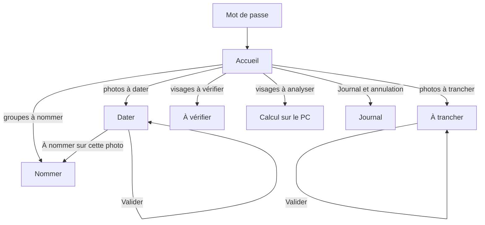

# Dossier de Millésime — tel que construit (version 1.5.0)

Rédigé le 11/11/2026 à partir du code, à la réouverture de l'appli pour la mettre au même format que carnet (2.9). Six sections, puis les écarts avec carnet et le socle commun, puis le plan proposé.

L'histoire de la conception (tests de mesure, décisions, verdicts du conseil, versions 1.0 à 1.5) reste dans [`conception-v2.md`](conception-v2.md) ; ce dossier décrit ce qui existe.

---

## 1. Besoin

Dater les photos papier numérisées qui n'ont pas de date, à partir de l'âge des visages connus et de leur date de naissance, sans rien envoyer hors de la maison.

| Besoin | Réponse actuelle |
|---|---|
| Proposer une année par photo | Âge estimé de chaque visage (MiVOLO v2, calculé sur le PC), calibré sur les scans datés par tampon, croisé avec les dates de naissance d'Immich |
| Ne jamais écrire sans accord | Validation photo par photo ; chaque écriture dans Immich est journalisée et annulable |
| Traiter les cas douteux à part | File « À trancher » : marge trop large, visages en désaccord, aucun visage exploitable |
| Nommer les visages inconnus | Écran Nommer : nouveau nom, ou fusion avec une personne d'Immich, annulable |
| Repérer les erreurs de fond | Écran À vérifier : visages dont l'âge estimé contredit l'âge connu |
| Faire tourner le calcul lourd ailleurs | Calculateur sur le PC, en veille ; l'appli affiche son état en direct |

Utilisateur unique, sur iPhone et sur PC, par le réseau local et Tailscale.

## 2. Technique

- **Back** : FastAPI (Python 3.12), un seul conteneur, port 8098. SQLite dans `/state` (un fichier, mode WAL).
- **Interface** : Svelte 5, Vite 6, Tailwind 4, sans bibliothèque de composants. Compilée dans l'image.
- **Immich** : clé API dédiée ; lecture des scans, visages et personnes ; écriture de la date, des tags, des albums, des noms et des fusions.
- **Calculateur du PC** (`pc/`, `mesure/`) : conteneur Docker Desktop qui interroge l'appli (`/api/calcul/*`) avec un jeton partagé.
- **carnet** : lit `GET /api/etat` avec un jeton.
- **Home Assistant** : rien ; `GET /api/ha/etat` répond « à venir ».
- **Connexion** : mot de passe unique (`MILLESIME_PASSWORD`, la stack lui donne la valeur de `CARNET_PASSWORD`), session par cookie.
- **Publication** : GitHub Actions lance les tests du back et compile l'interface, puis publie `ghcr.io/baloodusudouest/millesime` (`latest`, version, commit). Watchtower désactivé : mise à jour manuelle dans Portainer.
- **Tests** : 15 tests de l'appli (faux Immich, faux calculateur), 9 tests des outils de mesure. Aucun test d'écran.

## 3. Parcours des clics et des écrans

Adresses de la forme `#page` ou `#page/paramètre`.

**Navigation.** Sur PC : bandeau en haut avec sept liens (Accueil, Dater, À trancher, Nommer, À vérifier, Calcul sur le PC, Journal). Sur iPhone : barre du bas à quatre mots (Accueil, Dater, À trancher, Nommer) ; les trois autres écrans ne s'atteignent que par les liens du bas de l'Accueil.

| Écran | Gestes |
|---|---|
| Accueil | Bilan (photos datées sur le total, barre) ; cinq lignes cliquables avec leur nombre ; précision du calibrage ; Synchroniser maintenant ; état du PC ; encart « Home Assistant, à venir » ; Se déconnecter ; version |
| Dater / À trancher | Photo et visages ; année proposée ± marge, modifiables ; **Valider** (écrit dans Immich), Passer, Plusieurs années, Relire la photo dans Immich ; Annuler après une écriture ; visages à nommer sur la photo ; frises des personnes pour comparer |
| Nommer | Groupes de visages sans nom : nouveau nom, suggestion, aperçu côte à côte, fusion (annulable), ignorer ; personnes sans date de naissance |
| À vérifier | Visages suspects, par personne, avec lien vers Immich |
| Calcul sur le PC | Mode d'emploi du calculateur, nombre de visages en attente |
| Journal | Chaque écriture dans Immich, avec Annuler |

**Écriture à la validation** : date au 1er juillet à 12:00, tag « Date estimée/AAAA ±N », retrait de l'album des non datées, ajout à l'album de l'année.

## 4. Design

Habillage propre à Millésime, « cave à vin » : fond vert bouteille, texte ivoire, lie-de-vin pour agir, or pour ce qui est validé. Texte en Public Sans ; l'année proposée et les grands nombres en Bodoni, comme un millésime sur une étiquette. Sombre uniquement. Surfaces à filet, coins de 6 à 8 px. L'Accueil est une liste, pas une grille de tuiles.

## 5. Schéma de données

| Table | Contenu |
|---|---|
| `scans` | Une ligne par scan : type (non datée, datée), date du tampon, lot, statut (à analyser, à dater, à trancher, validée, plusieurs), année proposée, marge, raison, détails, année validée |
| `visages` | Un visage : scan, personne, naissance, cadre, âge du visage et du corps, date du calcul, personne masquée |
| `calibrages` | Versions du calibrage, avec leur précision mesurée |
| `journal` | Chaque écriture dans Immich (avant, après, date, annulation) |
| `groupes_ignores` | Groupes de visages écartés de Nommer |
| `frises` | Frise d'une personne, gardée en cache |
| `reglages` | Valeurs isolées (dernière synchronisation…) |

Migrations légères à l'ouverture (colonne ajoutée si absente). Pas de numéro de version du schéma.

## 6. Plan d'implémentation

Fait, du 03/11 au 11/11/2026 : deux tests de mesure, puis les versions 1.0 à 1.5 (détail dans `conception-v2.md`, sections 12 à 17).

Proposé pour la suite : voir « Plan proposé » en fin de dossier.

---

## Écarts avec carnet 2.9 et le socle

| # | Écart | Constat | Gravité | Proposition |
|---|---|---|---|---|
| 1 | Habillage | Thème « cave à vin » : fonds verts, Public Sans, sombre seulement | Voulu à l'origine, à aligner | Fonds neutres chauds et boutons de carnet, Inter, sombre par défaut et clair selon l'appareil. **Couleur de l'appli : lie-de-vin** (décision du 11/11). L'année en Bodoni et l'or du « validé » sont gardés : c'est la signature de Millésime |
| 2 | Navigation | Bandeau en haut sur PC ; barre de quatre mots sur iPhone ; trois écrans sans onglet sur iPhone | Moyen | Rail à gauche sur PC, pilule d'icônes en bas sur iPhone, comme carnet |
| 3 | Écran d'ouverture | Liste de cinq lignes | Moyen | Grille de tuiles « À traiter » : À dater, À trancher, À nommer, À vérifier, Sans naissance. Une tuile ouvre sa file. Le bilan (datées sur total) reste en tête |
| 4 | Services | Immich, PC, carnet et Home Assistant sont éparpillés (Accueil, Calcul sur le PC) | Moyen | Onglet **Connexion**, une tuile par service : Immich (voyant, Synchroniser), Calculateur du PC (état en direct, mode d'emploi), carnet (ce qu'il lit), Home Assistant (à venir) |
| 5 | Réglages | Pas d'écran ; déconnexion et version en bas de l'Accueil | Faible | Onglet **Réglages** : calibrage et précision, journal avec Annuler, déconnexion, version |
| 6 | Nombre d'onglets | Sept entrées | Moyen | Trois onglets : À traiter, Connexion, Réglages. Dater, À trancher, Nommer et À vérifier deviennent les files ouvertes par les tuiles |
| 7 | Lecture seule | Pas de mode lecture seule | Moyen | `MILLESIME_LECTURE_SEULE`, comme carnet : toute écriture dans Immich refusée, bandeau visible. Sert au premier jour d'une mise en service |
| 8 | Tests d'écran | Aucun | Moyen | Tests sur PC et sur iPhone avec un faux Immich, lancés sur GitHub, comme carnet |
| 9 | Publication | L'image attend les tests (mieux que carnet) ; les tests ne tournent que si certains dossiers changent | Faible | Garder ; ajouter les tests d'écran au même enchaînement |
| 10 | Documents | Pas de `REPRISE.md`, pas de journal des versions ; ce dossier est nouveau | Faible | `REPRISE.md`, `CHANGELOG.md`, ce dossier tenu à jour, miroir dans le projet |
| 11 | Données personnelles dans le dépôt public | Les noms de tags et d'albums par défaut contiennent un prénom (`config.py`, README) | **À corriger** | Défauts neutres dans le code ; les vrais noms passent par les variables de la stack, déjà prévues (`MILLESIME_TAG_PREFIXE`, `MILLESIME_ALBUM_NON_DATEES`, `MILLESIME_MODELE_ALBUM`). À faire **avant** le reste, avec les variables posées dans Portainer en même temps, sinon l'appli ne retrouve plus ses scans |
| 12 | Versions de l'interface | Sept dépendances avec `^` | Faible | Versions figées, comme carnet |
| 13 | Schéma | Pas de numéro de version | Faible | Ajouter un numéro, migrations additives seulement |
| 14 | Home Assistant | Rien ; encart « à venir » | Hors sujet ici | Laissé pour une version à part (capteur « photos à dater », rappel d'allumer le PC) |

**Déjà conforme, à garder :** FastAPI et Svelte dans un seul conteneur, session par cookie, même mot de passe que carnet, `/health`, journal des écritures avec annulation, Watchtower désactivé, étiquettes d'image permettant le retour arrière.

## Plan proposé

Trois livraisons, chacune utilisable seule.

| Version | Contenu | Vérification |
|---|---|---|
| **1.5.1** | Écart 11 seul : défauts neutres, variables dans la stack (`homelab.yml` mis à jour dans le projet) | Après redéploiement, l'Accueil affiche les mêmes nombres qu'avant |
| **1.6.0** | Documents (10), versions figées (12), numéro de schéma (13), lecture seule (7), tests d'écran sur l'interface actuelle (8) | Tests verts sur GitHub ; écriture refusée en lecture seule |
| **2.0.0** | Habillage (1), navigation (2), tuiles (3), Connexion (4), Réglages (5), trois onglets (6) | Captures PC et iPhone de chaque écran ; mise en service un jour en lecture seule ; retour arrière par `MILLESIME_VERSION=1.6.0` |

Aucune adresse de l'API ne change, ni le schéma, ni ce que Millésime écrit dans Immich : le calculateur du PC et carnet continuent de fonctionner sans modification.

**Ce qui reste à trancher par Julien :**
1. Trois onglets (À traiter, Connexion, Réglages) ou garder Dater et Nommer en onglets à part.
2. Le journal dans Réglages, ou dans Connexion › Immich.
3. Les trois livraisons, ou une seule comme la 2.9 de carnet.
